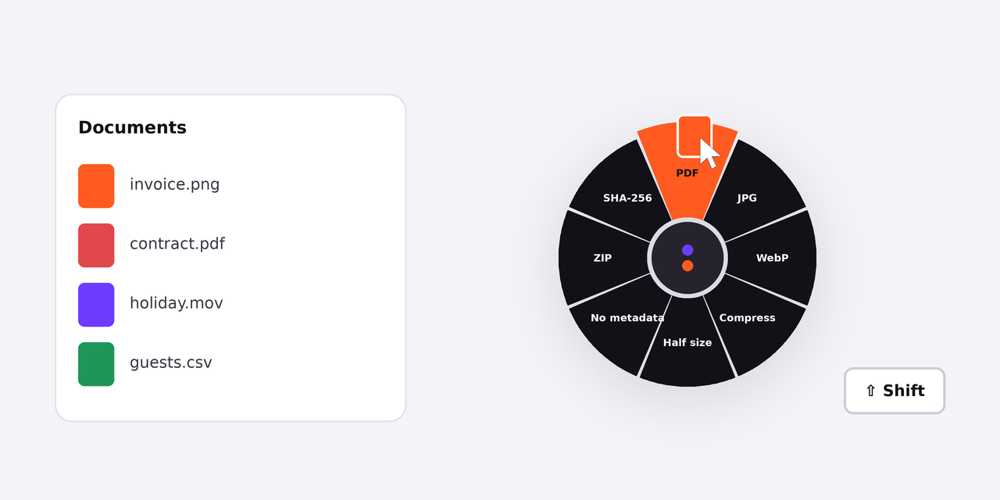
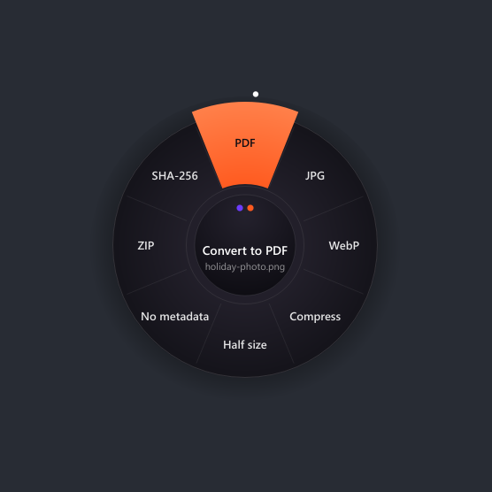

<p align="center">
  
</p>

<h1 align="center">Spicchio</h1>

<p align="center">
  <b>Drag a file. Press Shift. Drop it on a slice.</b><br>
  Convert, compress and transform files from a radial menu that opens under your cursor, without opening any app.
</p>

<p align="center">
  <a href="https://github.com/GiovanniBishara/Spicchio/actions/workflows/ci.yml"></a>
  
  
  
</p>

<p align="center">
  
</p>

*Spicchio* is Italian for a slice of a tangerine.

## How it works

1. Start dragging any file, from Explorer or the desktop.
2. While you are still holding the mouse button, tap **Shift**. A wheel opens under the cursor, with only the actions that make sense for that file.
3. Drop the file on a slice. The result is saved **next to the original**, which is never modified or overwritten (`photo.pdf`, then `photo (1).pdf`...).

<p align="center"></p>

Slices are picked by **direction**: keep moving towards a slice, even past the ring, so the file preview Windows draws next to the cursor never hides the labels. The chosen action is spelled out in the middle.

Dropping in the middle, or pressing **Esc**, cancels. A notification tells you what was created; click it to see the file in Explorer.

## What it can do

| Files | Slices |
| --- | --- |
| **Images** (PNG, JPG, WebP, GIF, BMP, TIFF) | PDF (several images become one PDF), PNG, JPG, WebP, Compress, Half size, Remove metadata (EXIF, GPS) |
| **PDF** | Merge (two or more PDFs), Images (one PNG per page), Compress, Split pages, Rotate, Extract text |
| **Video** (MP4, MOV, MKV, WebM, AVI) | MP4 (H.264), Compress, GIF, Mute, MP3 |
| **Audio** (MP3, WAV, M4A, OGG, FLAC) | MP3, WAV |
| **Data** | CSV → JSON (detects `;` and tabs), JSON → CSV (opens correctly in Excel) |
| **Anything** | ZIP, SHA-256 checksum |

Video and audio slices appear only if [ffmpeg](https://ffmpeg.org) is installed (`winget install ffmpeg`). Everything runs **offline**: no uploads, no accounts, no telemetry.

## Install and run

Requires Windows 10/11 and Python 3.10+.

```powershell
git clone https://github.com/GiovanniBishara/Spicchio.git
cd Spicchio
python -m venv .venv
.venv\Scripts\activate
pip install -e .
spicchio
```

Spicchio lives in the system tray. From its menu you can pause it, make it **start with Windows**, or quit.

### Build a standalone `.exe`

```powershell
pip install -e ".[dev]"
pyinstaller --noconfirm --noconsole --onefile --name Spicchio --icon assets/spicchio.ico --hidden-import pynput.keyboard._win32 --hidden-import pynput.mouse._win32 spicchio/__main__.py
```

The CI builds the same executable on every push: download it from the latest run under **Actions → Spicchio-windows**.

### Command line

Every slice is also available from the terminal, which is handy for scripts:

```powershell
spicchio actions                      # every action
spicchio list report.pdf              # what the wheel would show for this file
spicchio run pdf.split report.pdf     # report-pages\report-1.pdf, report-2.pdf, ...
spicchio run img.pdf a.jpg b.png      # a-album.pdf
```

## Under the hood

```
spicchio/
├── trigger.py      when to open: a tiny state machine fed by global mouse/keyboard hooks (pynput)
├── geometry.py     pure maths of the wheel: which slice is under the pointer
├── files.py        file kinds and collision-free output paths
├── actions/        one module per family; each action declares which files it accepts
│   ├── base.py     Action model and registry
│   ├── images.py   Pillow
│   ├── pdf.py      pypdf, pypdfium2
│   ├── media.py    ffmpeg
│   └── data.py     csv/json, zip, sha256
├── ui/
│   ├── wheel.py    transparent always-on-top Qt window that accepts the drop
│   └── toast.py    the notification
├── app.py          tray app, wiring and worker thread
└── cli.py          the same actions from the command line
```

A few decisions worth mentioning:

- **The wheel is a real drop target.** Windows does the drag and drop: Spicchio only shows a window under the cursor at the right moment and accepts the files, always as a *copy*, so Explorer never deletes or moves the original.
- **Logic is separated from the UI.** The trigger rules and the wheel geometry are plain Python and are unit tested without a mouse or a screen; the Qt wheel is rendered off-screen in CI.
- **Actions are data.** Adding a slice means writing one function and one `register(Action(...))` line; the wheel picks it up for the right file types.
- **Work happens off the UI thread**, so a long video conversion never freezes the cursor.

## Development

```powershell
pip install -e ".[dev]"
pytest          # 40+ tests: actions on real files, geometry, trigger, CLI, off-screen wheel
ruff check .
python scripts/make_assets.py   # redraws the icon and the illustration above
```

CI runs lint and tests on Windows and Linux with Python 3.11 and 3.13, then builds the Windows executable.

## Roadmap

- [ ] Office documents to PDF (Word, Excel, PowerPoint)
- [ ] OCR for scanned PDFs
- [ ] Background removal for images
- [ ] A settings window to choose and reorder slices
- [ ] macOS support

## Credits

Inspired by [Tangerine](https://www.digitaltrends.com/computing/tangerine-for-mac-makes-file-conversions-seamless-with-a-simple-drag-and-drop-gesture/), a macOS app built around the same gesture. Spicchio is an independent, open-source implementation for Windows.

Made by [Giovanni Bishara](https://www.linkedin.com/in/giovanni-bishara-912a63236). MIT licensed.
