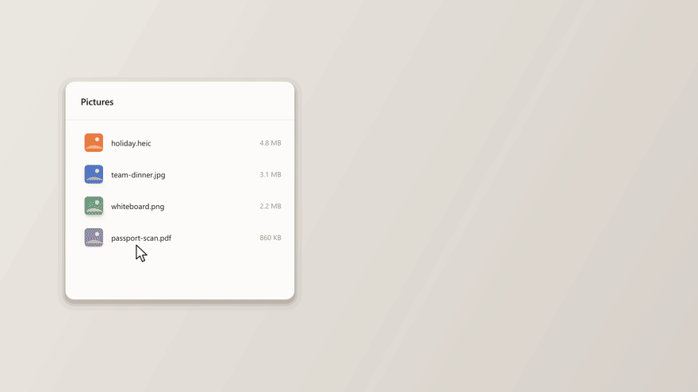

**Drag a file. Press Shift. Drop it on a slice.**

### What's new in 0.2

- **A new wheel: a ring of tangerine slices.** They unfold from the core; the one you point at lifts out in tangerine.
- **Three sides: Convert, Tools, Actions.** Tap Shift again (or Tab, or scroll) to turn the wheel.
- **Undo** in the notification: results go to the Recycle Bin, never the originals.
- **New actions**: iPhone photos (HEIC), Windows icon (ICO), **Under 1 MB** for images and **Under 20 MB** for videos, video Snapshot, M4A and FLAC, Copy path, Terminal here.
- **Recent results** in the tray menu, and a small "working" note for long jobs.
- **Security**: hostile files (image and PDF bombs, playlists disguised as videos, formulas hidden in data, symbolic links, planted programs) are handled. Details in [SECURITY.md](https://github.com/GiovanniBishara/Spicchio/blob/main/SECURITY.md).

### Download

| | |
| --- | --- |
| **Windows 10/11** | `Spicchio-windows.zip` → unzip → double-click `Spicchio.exe` |
| **macOS** (experimental) | `Spicchio-macOS.zip` → unzip → right-click `Spicchio.app` → Open |

The apps are attached a few minutes after publishing, built by GitHub Actions from this exact source. `SHA256SUMS.txt` lets you verify them (`Get-FileHash Spicchio-windows.zip` on Windows).

Windows may show "Windows protected your PC" because the app is not signed: click **More info → Run anyway**.
On macOS, allow Spicchio in **System Settings → Privacy & Security → Accessibility** and **Input Monitoring**, then open it again.

See the [README](https://github.com/GiovanniBishara/Spicchio#readme) for every action and for troubleshooting.
